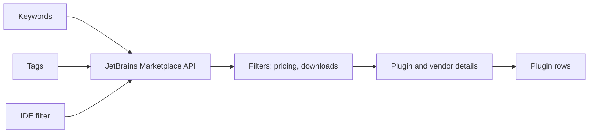

# JetBrains Plugins Scraper: Downloads, Ratings and Vendors

[](https://apify.com/Turboextract/jetbrains-plugins)
[](LICENSE)
[](#pricing)

**Export JetBrains Marketplace plugins by keyword, tag or IDE, with downloads, rating, rating count, pricing model, tags, vendor, verified flag, country, website, source code and last updated date.** Track IntelliJ plugin adoption, size up competitors and find dev tool companies. No API key.

In one test, the keyword `ai` matched 1,914 plugins, and the tag `Database` listed 440 plugins, 29 of the top 30 paid or freemium.

**Try it now →** [apify.com/Turboextract/jetbrains-plugins](https://apify.com/Turboextract/jetbrains-plugins)

---

## Why this exists

- The JetBrains Marketplace shows downloads one plugin page at a time.
- Vendor country, website and verified status sit on separate pages.
- There is no export button for a category or keyword.
- Dev tool teams need competitor installs and vendor lists in one sheet.

---

## Who this is for

- **Dev tool companies** tracking their plugin against competitors
- **Sales and partnership teams** looking for plugin vendors to work with
- **Product managers** sizing demand for an IDE integration
- **Investors and analysts** following AI coding tools by real installs
- **Plugin developers** finding gaps in a category

---

## What you get

```json
{
  "pluginId": 22282,
  "xmlId": "com.intellij.ml.llm",
  "name": "JetBrains AI Assistant",
  "url": "https://plugins.jetbrains.com/plugin/22282-jetbrains-ai-assistant",
  "downloads": 266181023,
  "rating": 2.12,
  "ratingCount": 1445,
  "pricingModel": "FREEMIUM",
  "tags": ["AI", "Code Editing", "Code Quality", "Code Tools"],
  "vendorName": "JetBrains s.r.o.",
  "vendorType": "Organization",
  "vendorVerified": true,
  "vendorCountry": "Czech Republic",
  "vendorWebsite": "https://www.jetbrains.com/",
  "vendorEmail": "support@jetbrains.com",
  "docsUrl": "https://www.jetbrains.com/help/ai-assistant/",
  "issueTrackerUrl": "https://youtrack.jetbrains.com/issues/LLM",
  "lastUpdated": "2026-11-26",
  "query": "ai"
}
```

The sample is shortened. Rows also include summary, source code URL, vendor page and icon. Vendor emails are only included for organizations that show them publicly, never for individual developers.

---

## How it works



---

## Quick start

1. Click **Try for free**.
2. Add **Search keywords**, like `ai` or `docker`, or **Tags**, like `Database`.
3. Optional: pick an **IDE**, a **Pricing** model and **Minimum downloads**.
4. Click **Start**, then export to CSV, JSON, Excel or Google Sheets.

### API

```bash
curl -X POST "https://api.apify.com/v2/acts/Turboextract~jetbrains-plugins/run-sync-get-dataset-items?token=YOUR_TOKEN" \
  -H "Content-Type: application/json" \
  -d '{"tags": ["AI"], "pricing": "paid-or-freemium", "maxResults": 200}'
```

### Python

```python
from apify_client import ApifyClient

client = ApifyClient("YOUR_TOKEN")
run = client.actor("Turboextract/jetbrains-plugins").call(run_input={"searchQueries": ["kubernetes"], "product": "GO"})
for row in client.dataset(run["defaultDatasetId"]).iterate_items():
    print(row["name"], row["downloads"], row["vendorName"])
```

---

## Input fields

| Field | Default | What it does |
|---|---|---|
| `searchQueries` | – | Words to search plugins |
| `tags` | – | Marketplace tags, like AI or Theme |
| `product` | any | Only plugins for this IDE |
| `sort` | downloads | Downloads, rating, updated, newest or relevance |
| `pricing` | any | Free, paid, freemium |
| `minDownloads` | 0 | Skip smaller plugins |
| `includeDetails` | true | Rating count, vendor and links |
| `maxResults` | 50 | Total cap per run |

Empty input lists the whole marketplace by downloads.

---

## Pricing

**$0.0005 per plugin delivered.** 1,000 plugins cost $0.50.

| Option | 1,000 plugins |
|---|---|
| **JetBrains Plugins Scraper** | **$0.50** |
| Manual research | hours of copy and paste |
| Market intelligence tools | $100+ a month |

---

## Common use cases

- **Competitor tracking**: downloads and ratings of rival plugins
- **Lead lists**: companies with paid plugins, with country and website
- **AI coding market map**: every AI plugin by installs
- **Category research**: gaps where top plugins rate poorly
- **Weekly reports**: schedule a run and compare downloads over time

---

## Tips for best results

- Tags work best for whole categories; keywords for products and brands.
- Turn off **Include vendor details** for a faster run with downloads and rating only.
- Sort by **Newest** to catch new plugins as they launch.
- The marketplace returns up to 10,000 plugins per search.

---

## Pairs well with

- [VS Code Extensions Scraper](https://apify.com/Turboextract/vscode-extensions): the same view for VS Code
- [NuGet Packages Scraper](https://apify.com/Turboextract/nuget-packages): .NET libraries with downloads and owners
- [Chrome Extension Leads](https://apify.com/Turboextract/chrome-extension-leads): Chrome Web Store extensions and developers

---

## FAQ

**Do I need a key?** No. The actor uses the public JetBrains Marketplace API.

**Which IDEs are covered?** IntelliJ IDEA, PyCharm, WebStorm, PhpStorm, GoLand, CLion, Rider, RubyMine, RustRover, DataGrip, DataSpell and Android Studio.

**Why is the rating low for some big plugins?** The rating is the marketplace average of all votes. Popular plugins often collect many one star votes.

**How fresh is the data?** Live. Every run reads the marketplace at that moment.

**Is it legal?** It reads public listing data from the official API. Personal emails of individual developers are not exported.

---

## SEO keywords

JetBrains plugins scraper, JetBrains Marketplace API, IntelliJ plugin downloads, PyCharm plugins list, IDE plugin market data, AI coding plugins, plugin vendor leads, export JetBrains plugins to CSV

---

## Support

- Actor page: https://apify.com/Turboextract/jetbrains-plugins
- Issues and questions: open an issue in this repo
- Community Discord: https://discord.gg/8SrXSCpvgj

Built and maintained by [Turboextract](https://apify.com/Turboextract) on the Apify platform.

---

## License

The documentation and examples in this repository are MIT licensed. The actor itself runs on the Apify platform.
